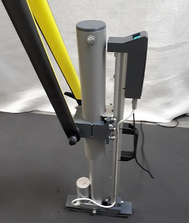
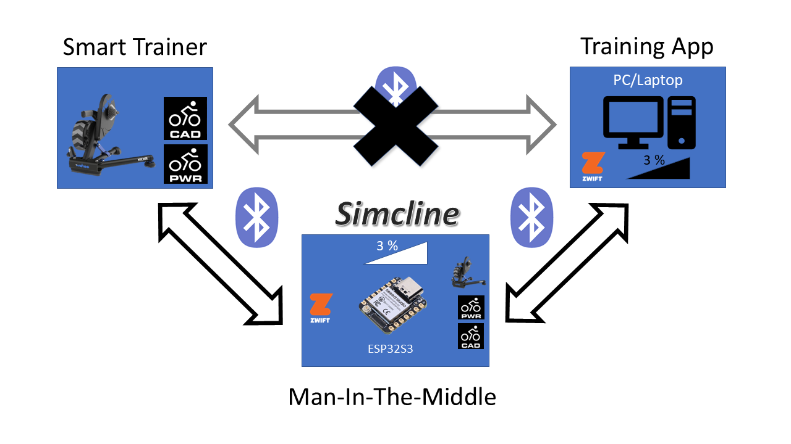
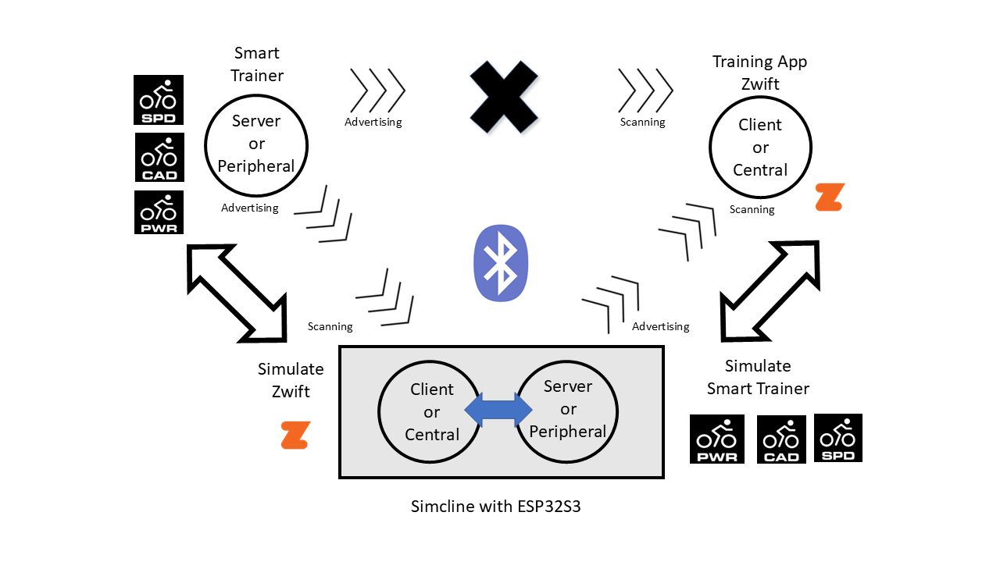

#  &nbsp; Simcline-V3 for Smart Trainers

[](LICENSE)
[](https://github.com/Berg0162/Simcline-V3/releases)
[](https://www.espressif.com/en/products/socs/esp32)
[](https://github.com/Berg0162/Simcline-V3/issues)
[](https://github.com/Berg0162/Simcline-V3/discussions)

# Simulation of Changing Road Inclination for Indoor Cycling<br>

The SIMCLINE physically adjusts the bike position to mimic hilly roads, climbing and descending. This allows the rider to naturally change position on the bike, engage climbing muscles, and improve pedaling technique to become a more efficient and powerful climber.<br>
Without user intervention the SIMCLINE will replicate inclines and declines depicted in (online & offline) training programs (like <b>Zwift, Rouvy, VeloReality, myWhoosh</b> and many others) that adjust accordingly the resistance of the indoor trainer.<br>
The SIMCLINE auto connects at power up with a Smart trainer and lets you relive the ascents and descents from favorite rides or routes while training indoors. The physical reach is: 20% maximum incline and -10% maximum decline. However, the reach that the rider is comfortable with can be adjusted! The SIMCLINE pairs directly to the Smart trainer and with your PC/Laptop/Tablet with (Zwift) training App for a connection that notifies the SIMCLINE to autonomously simulate the physical road grade during an indoor ride. During operation an OLED display shows the road grade in digits and in graphics. <br clear="left"> <br>
Notice that the description on how to build SIMCLINE consists of two parts:

+ <b>Mechanical SIMCLINE 2.0</b><br> 
 &nbsp; [SIMCLINE 2.0 Instructables](https://www.instructables.com/SIMCLINE-20-Easy-Simulation-of-Road-Incline/) 
<br clear="left">

+ <b>Present Simcline-V3 Library</b><br>
 <br>

# Simcline-V3 Library for ESP32-S3 and NimBLE-Arduino 2.x!<br>
The <b>ESP32-S3</b> family contains low-cost, low-power System on a Chip (SoC) microcontrollers developed by Espressif. They combine WiFi, Bluetooth, generous memory options and a dual-core processor. These properties make the ESP32-S3 a very attractive choice for the project! See: &nbsp;[FAQ #5](docs/Frequently_Asked_Questions.md#5)<br>
- The preferred board is the <b>Seeed Studio XIAO ESP32-S3 (plus OLED display)</b>. It has been proven to work well for SIMCLINE with the latest library. Due to its thumb-size, it definitely fits in the component box, although it needs some special care to mount it stably. For settings, wiring scheme and more, see: [Seeed Studio XIAO ESP32-S3](docs/XIAO_ESP32S3_Sense.md)

Notice that other members of the <b>ESP32-S3</b> family can also do the job perfectly, especially when the development boards come with **extra Flash** and PSRAM memory! See: &nbsp;[FAQ #7](docs/Frequently_Asked_Questions.md#7). &nbsp; <br>
- For example SIMCLINE works successfully with the <b>Lilygo ESP32-S3 T-Display</b> board, however that Lilygo-board needs another size component box! See: [Lilygo ESP32-S3 T-Display](docs/LILYGO%20ESP32S3%20T-Display.md) for settings, wiring scheme and more.<br>

Simcline-V3 builds on the experience, knowledge and code of Simcline projects since <b>2020</b>. The original Simcline code has been revisited and redesigned for better stability, robustness and modularity. It was transformed to a C++ object model that hides most of Simcline's internal operation from the normal user. The Simcline community is very diverse when it comes to programming skills: many users are enthusiastic cyclists first and programmers second. The present Simcline-V3 library matches this much better! It also supports a greater variety of ESP32 boards and displays.<br>

# What is new in Simcline-V3?
Simcline-V3 is the new self-contained SIMCLINE library line. It will exist side-by-side with Simcline-V2 during the transition period, so existing users have a reliable fallback while V3 becomes the main maintained version.

The most important V3 changes are:
+ <b>Dynamic BLE trainer discovery:</b> Simcline-V3 learns what BLE services and characteristics the trainer exposes and mirrors these dynamically toward Zwift or another training app. In plain words: Simcline-V3 tries to behave like the trainer that it actually finds.
+ <b>No trainer profile has to be selected before compiling:</b> classic FTMS trainers, trainers with Cycling Power or Speed/Cadence services, Tacx FE-C, Wahoo proprietary control points and Zwift Virtual Shifting can be handled through the same more general MITM architecture.
+ <b>Robust BLE traffic handling:</b> Simcline-V3 has a stronger internal architecture for handling BLE reads, writes, subscriptions, notifications and reconnects. In particular, trainer-control writes from Zwift are queued and forwarded by a dedicated FreeRTOS write bridge, so short bursts of Write With Response and Write Without Response commands can be handled reliably without blocking the BLE callback path. Passive observers can inspect these writes for road-grade information, but the original trainer command is still forwarded unchanged.
+ <b>Startup WiFi configuration:</b> settings can be changed in a browser during a short startup window. This replaces the older Android companion app approach.
+ <b>ESP32-S3 focus:</b> the recommended board is the Seeed Studio XIAO ESP32-S3 because it is small, low cost and has comfortable memory headroom for BLE, WiFi configuration, display handling and lifter control. [Webshop](https://www.tinytronics.nl/en/development-boards/microcontroller-boards/with-wi-fi/seeed-studio-xiao-esp32-s3)

More technical details are collected in [What is new in V3](docs/whatsNew-V3.md).<br>

# The Simcline-V3 design separates completely:
+ presentation (display types/properties)
+ specific ESP32 board properties (pinout and initialization)
+ BLE operation<br>

To achieve this the design has implemented Abstract Base Classes for ESP32 board and Display. As a consequence the <b>novice programmer/user</b> only has to change config settings to select between <b>standard</b> board- and display-types that are supplied with Simcline-V3. However, a <b>proficient programmer/user</b> can implement Concrete Classes for ESP32-board-type and Display-type of his/her choice easily without interfering with the Simcline BLE operational code.<br>
Benefits of this Approach:
+ Scalability: Easily add new display types by creating new concrete classes implementing the IDisplay interface.
+ Maintainability: Changes to one display type do not affect others.
+ Flexibility: Change the display type used by the Presentation class without modifying its implementation.<br>

As a result the Arduino ino-files that the user will access, in the `Simcline-V3/examples` folder, are very concise in comparison with the old code files. <br>

# Simcline-V3 has central configuration
All configuration settings have been gathered in one `src/config` directory inside the installed Simcline-V3 library folder. This includes <b>Board</b>-, <b>Debug</b>-, <b>Display</b>-, <b>NimBLE</b>-, <b>Portal</b>- and <b>Simcline</b>-configurations. Check this out:  [Simcline-V3 Configuration](src/config/README.md)<br>

# NimBLE-Arduino 2.x
The Simcline project heavily leans on the <b>NimBLE-Arduino</b> library for Bluetooth handling, see: [H2Zero/NimBLE-Arduino](https://github.com/h2zero/NimBLE-Arduino). <b>NimBLE-Arduino</b> is structured for compilation with Arduino and for use with ESP32! Simcline-V3 works only (!) with the latest version: <b>NimBLE-Arduino Version 2.x</b>!<br>

# FiTness Machine Service a Bluetooth Service Specification
From 2015 to 2017 the Sports and Fitness Working Group (SIG) designed a Bluetooth Service specification. This service exposes training-related data in the sports and fitness environment, which allows a Server (e.g., a fitness machine) to send training-related data to a Client. In February 2017 the service specification reached a stable version: [Fitness Machine Service 1.0](https://www.bluetooth.com/specifications/specs/fitness-machine-service-1-0/) when it was adopted by the Bluetooth SIG Board of Directors. Have a look at the document to appreciate the effort of all the contributors and the companies they represented!<br>
<b>FTMS</b> is an open (nonproprietary) protocol that is not owned by any particular company and not limited to a particular company's product. It can be compared in that respect with FE-C over ANT+, however <b>FTMS</b> is targeted to control fitness equipment over <b>Bluetooth</b>! Today <b>Bluetooth Smart FTMS</b> is the absolute industry standard for indoor trainers and Simcline-V3 is primarily targeted at <b>FTMS</b>! <br>

# Zwift Virtual Shifting (VS): Emerging De-Facto Standard

Virtual Shifting has rapidly become a dominant hardware trend for indoor cycling in 2025. While it currently complements—rather than fully replaces—traditional mechanical cassettes, its adoption is accelerating across both trainers and control devices.

Virtual Shifting allows riders to “change gears” on a smart trainer without interacting with the bicycle’s drivetrain. Instead of physically moving the chain across sprockets, software simulates different gear ratios and dynamically adjusts trainer resistance. From the rider’s perspective, shifting is now handled entirely by the trainer and the training platform, rather than by mechanical components on the bike.

## Current Market Standing

**Industry Adoption**  
Major manufacturers including **Elite**, **JetBlack**, **Wahoo**, and **Garmin (Tacx)** now support Virtual Shifting on their latest trainer models, often marketed as *“Zwift Ready”*.

- Garmin (Tacx) considered the 2025 Virtual Shifting firmware update so significant that, in their most recent firmware releases, the traditional **FTMS service has been replaced by the Zwift Virtual Shifting service**.

**Ecosystem Lock-In**  
Although platforms such as [Rouvy](https://rouvy.com/virtual-shifting) have added support, Virtual Shifting remains largely tied to the **Zwift BLE protocol**. Most other training platforms still rely on a physical cassette for gear changes.

**Legacy Hardware Constraints**  
Support for Virtual Shifting is firmware-dependent. Many older trainers (e.g. Tacx Neo, Zwift Hub One, Wahoo KICKR v5, and others) cannot be updated to support Virtual Shifting and therefore remain limited to conventional shifting via FTMS.

## Simcline-V3 and Zwift Virtual Shifting

Within the **Zwift BLE protocol**, the current road inclination —just as with FTMS— is transmitted to the trainer. This data can be intercepted by a **Man-In-The-Middle (MITM)** implementation and redirected to a secondary target: the mechanical Simcline device.

From a Simcline-V3 perspective, the principle is unchanged:

- **FTMS** and **Zwift Virtual Shifting** both transport trainer-related data over BLE.
- Zwift Virtual Shifting is simply an **additional BLE service** with a different data model.
- Inclination data remains available and can be processed in exactly the same way as with **FTMS**.

This Simcline-V3 version therefore supports **Zwift Virtual Shifting**, enabling Simcline actuation when Virtual Shifting is active.

> **Important:** Zwift Virtual Shifting support requires a trainer running the firmware that explicitly supports the **Zwift Virtual Shifting** protocol.

## ⚠️Library dependencies

Simcline-V3 is distributed as one complete integrated Arduino library. Arduino
compiles the library source as a unit, so all core dependencies must be
installed even when an introductory example does not exercise every component.

Required for all Simcline-V3 examples:

- **NimBLE-Arduino** 2.5.0 or newer compatible 2.x version
- **VL6180X** 1.4.0 or newer by Pololu
- Bolder Flight Systems **ULEB128** 2.1.2 or newer

Additional display dependencies:

- OLEDSSD1306_128x64: Adafruit SSD1306 and Adafruit GFX Library
- LILYGO_T_DISPLAY_S3: TFT_eSPI
- NODISPLAY or SERIALDISPLAY: no external display library
  
# Man-In-The-Middle (MITM) software pattern<br>
<br>
<b>Man-In-The-Middle</b> is a powerful software engineering pattern that is applied in many software designs. Unfortunately it is also known for a negative application in communication traffic: MITM is a common type of cybersecurity attack that allows attackers to eavesdrop on the communication between two targets.
We have applied the very principle: the Simcline is strategically positioned in between the BLE communication of the Smart Trainer and the training App (like Zwift) running on the PC/Laptop. All communication traffic can be inspected in that MITM position, while it is passed on from one side to the other, in both directions. When Zwift sends resistance information (like the road inclination) to the Smart trainer, this information can be intercepted and applied to determine the up/down positioning of the Simcline. <br>

# How to start?<br>
Take your time here. Most problems with Arduino projects are caused by one small installation or board-selection step that was skipped.
> **Simcline-V3 is a complete integrated library. The examples expose progressively more functionality, but all library dependencies must be installed before compiling any example.**

1. Install [Arduino IDE 2](https://www.arduino.cc/en/software#experimental-software).
2. Install the [ESP32 board package](https://randomnerdtutorials.com/installing-esp32-arduino-ide-2-0/) in Arduino IDE.
3. Install the ESP32 NimBLE-Arduino library (<b>Version 2.5.#</b>). In <b>Arduino IDE</b> go to <br>`Sketch menu` -> `Include Library` -> `Manage Libraries`, search for NimBLE-Arduino and install.
4. Install [uleb128](https://github.com/bolderflight/uleb128) to run the optional Virtual Shifting BLE Service → Unsigned little endian base 128 implementation for encoding and decoding ZVS-data-streams
5. Install [VL6180X by Pololu](https://github.com/pololu/vl6180x-arduino) Time Of Flight (**TOF**) Sensor to measure distance.
6. Optionally Install [Adafruit OLED and GFX Libraries](https://makeabilitylab.github.io/physcomp/advancedio/oled-libraries.html), when you use an OLED display.
7. Install the Simcline-V3 library from this repository. Download as `.zip` and extract to the Arduino `libraries` folder, or <br>use <b>Arduino IDE</b>: `Sketch menu` -> `Include library` -> `Add .Zip library`.
8. Open the example you want to test: `File > Examples > Simcline-V3 > Smart-MITM`.
9. Select your ESP32 board and upload the sketch.
10. Open Serial Monitor, power on the trainer, and only start Zwift after Smart-MITM has connected to the trainer.<br>

# How to make it work?<br>
The requirements in this phase are simple: 
+ running Zwift, Rouvy or myWhoosh app or alike, 
+ working XIAO ESP32-S3 development board, or another suitable ESP32-S3 board, and 
+ working Smart Trainer,
+ running Simcline-V3 library and Smart-MITM application.<br>

## Which example should I run?

Simcline-V3 provides three main applications. They use the same library and
configuration files but enable progressively more Simcline functionality.

### 1. Smart-MITM

Start here.

Smart-MITM tests the Bluetooth man-in-the-middle bridge between the indoor
trainer and a training application such as Zwift. It does not operate the
Simcline lifter and does not require a physical display.

The presentation subsystem is still initialized when **NODISPLAY** is selected.
NODISPLAY supplies a no-output presentation implementation; it does not disable
presentation initialization.

Smart-MITM permits first-time connections from unknown devices. When the trainer
and training application connect successfully, their Bluetooth addresses are
stored in ESP32 non-volatile storage (NVS).

### 2. Smart-MITM-xtra

Run this after Smart-MITM when a supported display is connected.

Smart-MITM-xtra performs the same Bluetooth bridge test and adds visible road
grade, pairing messages, and trainer/application connection indicators. It does
not operate the lifter.

### 3. Smart-Simcline

Run this only after:

1. Smart-MITM has successfully connected to the intended trainer and training
   application;
2. their Bluetooth addresses have been stored in NVS;
3. the board, display, actuator, limit switches, and VL6180X sensor have been
   configured and tested with the component test examples.

Smart-Simcline starts the complete Simcline application. It initializes and
tests the actuator, starts the lifter control task, and converts received road
grades into physical target positions.

Unlike Smart-MITM, Smart-Simcline normally reconnects to the known devices
stored during the introductory Smart-MITM test. If the intended devices change,
run Smart-MITM again to perform discovery and update the stored addresses.

# Testing is Knowing!<br>
I can understand and respect that you have some reserve: Is this really working in my situation? Better test if it is working, before buying all components and start building.
In the Simcline-V3 Library <b>Examples</b> section you will find the applications for testing and running SIMCLINE that come with the library. The one you should start with is <b>Smart-MITM</b>. It is developed to check whether the MITM solution works with your trainer, your training app and your ESP32 board.<br>Within Arduino IDE 2 select on the top bar menu: `File > Examples > Simcline-V3 > Smart-MITM`<br>

<b>Smart-MITM application, what it does in short:</b><br>
<br>
A working <b>MITM</b> implementation links a bike trainer and a PC/Laptop/Tablet running Zwift or another training app with the XIAO ESP32-S3, like a <b>bridge</b> in between. The MITM bridge can pass on, inspect, control, filter or alter the interchanged traffic data! The <b>MITM</b> test code is fully ignorant of the mechanical or electronic components that drive the Simcline construction.<br>
```
It simply establishes a virtual BLE bridge and allows you to ride the bike on the Smart Trainer and 
feel the resistance that comes with the route you have chosen, thanks to Zwift.
The experience should not differ from a normal direct one-to-one connection, Zwift - Smart Trainer!
```
Many Bluetooth Smart FTMS indoor trainers expose the rider's efforts in additional BLE services such as Cycling Power (CPS) and Speed & Cadence (CSC). Training apps often expect these services to be present. The Zwift pairing screen is a good example: it can connect Power Source, Resistance and Cadence separately.

Simcline-V3 does not require the user to select these services before compiling. Instead, it first discovers what the trainer actually exposes and then builds a mirrored BLE server from that discovered information.
+ The client-side (XIAO ESP32-S3) scans for a trainer, connects to it, and discovers the trainer's BLE services and characteristics. The <b>Simcline Client</b> is doing that at the left side of the "bridge"!
+ The Server-side (XIAO ESP32-S3) advertises the discovered/mirrored trainer toward training/cycling/game apps like Zwift. To Zwift it should look like the trainer it normally expects to connect to. The <b>Simcline Server</b> is doing that at the right side of the "bridge"!
+ The <b>Simcline MITM</b> code is connecting both sides at the same time: a full-blown working bridge<br clear="left">

# Load Smart-MITM application in Arduino IDE 2
Within the Arduino IDE 2.x select on the top bar menu: `File > Examples > Simcline-V3 > Smart-MITM`<br>
The default Simcline-V3 configuration settings for Smart-MITM when using <b>any ESP32 board (without display attached)</b> are: 
+ Display: <b>NODISPLAY</b>
+ ESP32 board: <b>YOUR_ESP32_BOARD</b>
+ NimBLE: dynamic trainer discovery and mirrored BLE server
+ Debug:  <b>Defined</b>

Optionally:
+ Users with a <b>XIAO ESP32-S3</b> can set up their board and optionally the display now! See: [Setup XIAO ESP32-S3 plus OLED display](docs/XIAO_ESP32S3_Sense.md)
+ Users with a <b>Lilygo ESP32-S3 T-Display</b> can set up the board and display now! See: [Setup Lilygo ESP32-S3 T-Display](docs/LILYGO%20ESP32S3%20T-Display.md)<br>
<br>

<b>Smart-MITM</b> is default in Debug mode: using Serial Monitor (logging on the PC-screen) to show you what is happening!<br>

When the settings match your desired setup, it is time to run Smart-MITM!

# Compile and Upload Smart-MITM to your ESP32 board
A recipe for success: follow <b>ALWAYS</b> the instructions and procedure at the top of the respective program codes!
```
/* -----------------------------------------------------------------------------------------------------
 *             This code is intended to work with indoor cycling trainers that expose
 *        BLE trainer services that can be discovered and mirrored by Simcline-V3.
 * ------------------------------------------------------------------------------------------------------
 * NOTICE: that you need to have set first all config file settings in accordance with your specific setup!
 *         see: ../Documents/Arduino/libraries/Simcline-V3/src/config
 *
 *  The code links a BLE Server (a Peripheral to Zwift) and a BLE Client (a Central to the Trainer) with a bridge 
 *  in between, the ESP32 being man-in-the-middle (MITM). The ESP32 is an integral part of the Simcline design,
 *  that interprets the exchanged road grade and moves the front wheel up and down with the change in inclination.
 *  The ESP32-bridge can control, inspect, filter and alter the bi-directional interchanged data!
 *  The client-side (central) scans for the Trainer, connects to it and discovers its BLE services.
 *  For classic FTMS trainers this often includes FTMS, Cycling Power and Speed & Cadence.
 *  For other trainers the discovered service set can be different.
 *  The client-side supplies the Indoor Trainer with target and resistance control data.
 *  The server-side (peripheral) advertises the mirrored Trainer and enables connection with cycling apps like Zwift.
 *  It collects the app's control commands, target and resistance data. It passes these on to the client-side....  
 *  The server-side supplies the app with the generated cycling data in return. 
 *  
 *  The client plus server (MITM) are transparent to the Indoor Trainer as well as to the training app Zwift or alike!
 *  
 *  Requirements: Zwift app or alike, ESP32 board (NO display required) and a supported Indoor Trainer
 *  0) Upload and Run this code on your ESP32 board
 *  1) Start the Serial Monitor to catch debugging info
 *  2) The code will do basic testing of electronic parts and settings
 *  3) Start/Power On the Indoor Trainer  
 *  4) Your ESP32 and Trainer will pair as reported in the output
 *  5) Start Zwift on your computer or tablet and wait....
 *  6) Search on the Zwift pairing screens for your ESP32 a.k.a. SIM32
 *  7) Pair: Power Source, Resistance and Cadence one after another with SIM32
 *  8) Optionally one can pair as well devices for heartrate and/or steering (Sterzo)
 *  9) Start the default Zwift ride or any ride you wish
 * 10) Make Serial Monitor output window visible on top of the Zwift window 
 * 11) Hop on the bike: do the work and feel resistance change with the road
 * 12) Inspect the info presented by Serial Monitor.....
 *  
 *   This device is identified with the name SIM32. You will see this only when connecting to Zwift on the 
 *   pairing screens! Notice: Zwift extends device names with additional numbers for identification!
 *  
*/ 
```
## WiFi Portal and BLE Scanning

The startup configuration portal is opened for 60 seconds. During this same
startup phase Simcline-V3 also scans for the smart trainer.

On ESP32-S3, WiFi and BLE share the same 2.4 GHz radio. While BLE scanning is
active, the WiFi portal may respond slowly or may not be reachable at all. This
is expected behavior. In practice the portal becomes reliably accessible after
the trainer has been found and connected, or after the trainer scan has timed out.

For this reason, if you want to change settings through the browser portal,
power on Simcline-V3 first and wait until trainer connection has completed, or
until the trainer scan timeout has passed. The portal remains open during the
startup window, so there is still time to adjust and save settings before the
ride begins.

# Points of Interest
+ Be aware of unwanted <b>autoconnect</b> of Zwift with your trainer using ANT+ or BLE Smart before <b>Smart-MITM</b> can establish a connection. Always <b>start</b> Zwift <b>AFTER</b> Smart-MITM and the trainer have connected successfully! If Zwift connects directly to the trainer first, Smart-MITM may fail to connect and the test result is no longer representative. Only one client can control the trainer at the same time: two captains on one ship is a recipe for disaster! See for more info [FAQ #1](docs/Frequently_Asked_Questions.md#1) and [FAQ #6](docs/Frequently_Asked_Questions.md#6)
+ Please write down the presented MAC/Device Addresses of a) your Smart trainer and b) your Desktop/Laptop with Zwift. These show up in the Serial Monitor output when running the Smart-MITM test code. This is for your own convenience since it helps you to identify later both devices by MAC Addresses! Smart-MITM detects the Mac addresses and stores these in ESP32 NVS (Non-Volatile-Storage) for later use to unmistakably establish a BLE connection with the targeted devices. See [FAQ #9](docs/Frequently_Asked_Questions.md#9)
+ When you see different road grade values in the Zwift window compared with the Simcline display or in the Serial Monitor output, this can have different reasons! See: [FAQ #8](docs/Frequently_Asked_Questions.md#8)
# What's next?
When you are pleased with the results so far, you can consider setting up the complete SIMCLINE mechatronic system.<br>
+ Mechanical Assembly <br>
 &nbsp; [SIMCLINE 2.0 Instructables](https://www.instructables.com/SIMCLINE-20-Easy-Simulation-of-Road-Incline/) 
<br clear="left">

+ Embedded Control System <br>
[Setup Simcline Control System](docs/Setup_SIMCLINE.md)<br>
