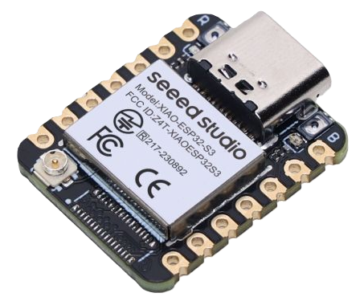

## What Is New In Simcline-V3

Simcline-V3 is the next full version of SIMCLINE. It is planned as a
self-contained library and repository with its own examples, configuration,
documentation, images, and project files.

Simcline-V3 will exist side-by-side with Simcline-V2 during the transition
period. This gives existing users a stable fallback while the new dynamic BLE
architecture is tested with more smart trainers. When V3 has proven itself in
daily use, Simcline-V2 can be archived as the previous generation.

Simcline-V3 keeps the proven SIMCLINE concepts for the mechanical lifter,
display abstraction, presentation layer, operations state, and board support,
but modernizes two major parts of the software architecture:

- BLE trainer services are discovered and mirrored dynamically.
- User settings are changed through a short startup WiFi configuration portal
  instead of an Android companion app.

## Main Difference Compared With Simcline-V2

Simcline-V2 uses predefined BLE services and characteristics. The user selects
the expected trainer profile before compiling.

That approach works well when the trainer profile is known in advance, but it is
less flexible when different trainers expose different combinations of services,
characteristics, proprietary control points, or virtual shifting services.

Simcline-V3 changes this into a dynamic BLE GATT mirror:

1. `BleClientBackend` connects to the real trainer as a BLE client.
2. It discovers the trainer's advertised services and characteristics.
3. The trainer-side GATT information is stored in lightweight
   `GattCharacteristic` records.
4. `BleGattMirror` builds a local BLE server that mirrors the discovered trainer
   services toward Zwift or another training app.
5. Reads, writes, subscriptions, notifications, and reconnect handling are
   bridged between the training app and the trainer.

This means the core MITM is no longer built around one predefined trainer
profile. The local GATT server is created from what the trainer actually exposes.

Only selected passive observation hooks are protocol-specific. These hooks peek
at write traffic to extract useful information, such as road grade, without
changing or delaying the BLE command that is forwarded to the trainer.

## Startup WiFi Configuration Portal

Simcline-V2 uses an Android app over BLE UART/NUS to change user settings.

Simcline-V3 uses a lightweight WiFi portal during startup. The portal opens for
a limited time before the ride and lets the user adjust settings in a browser.
After the startup window, WiFi is stopped so the ride itself can focus on BLE
traffic.

`Operations` remains the single source of truth for settings, validation, and
NVS storage. The configuration portal does not keep a parallel preference store.

This makes Simcline-V3 independent of an Android APK and easier to configure
from any phone, tablet, or computer with a browser.

## Recommended Hardware

The preferred board for Simcline-V3 is the **Seeed Studio XIAO ESP32S3**.<br>

It is currently the best fit for this project because it is:
- low cost small powerhouse
- widely available
- based on ESP32-S3
- equipped with enough memory headroom for NimBLE, the display layer, the lifter
  control task, and the startup WiFi configuration portal
<br clear="left">

In Simcline-V2 the Adafruit Feather ESP32 V2 was a very good default choice.
For Simcline-V3, the XIAO ESP32S3 is the stronger recommendation. Some newer
Adafruit Feather ESP32-S3 variants have less comfortable memory margins for this
combination of BLE, WiFi, display, and lifter code.

Other ESP32-S3 class boards can work, but they should be checked carefully for
available flash, PSRAM, pin availability, I2C/SPI display wiring, and actuator
control pins.

Previous-generation ESP32 boards may still compile parts of the project, but
they are not the intended V3 target. In particular, they may not have enough IRAM
headroom to run the BLE MITM and the WiFi configuration portal in the same
feature set. On those targets the configuration portal can be dropped at compile
time.

## Architecture Overview

The main BLE data path is:

```text
Zwift / training app
        |
        | BLE central connection
        v
BleGattMirror
        |
        | mirrored reads, writes, subscriptions, notifications
        v
BleWriteBridge / backend calls
        |
        | BLE client connection
        v
Smart trainer
```

Important components:

- `BleClientBackend`  
  Connects to the trainer, discovers services and characteristics, performs
  trainer reads/writes/subscriptions, handles reconnects, and forwards trainer
  notifications to the mirror.

- `BleGattMirror`  
  Builds the local GATT server from the backend discovery result, advertises the
  mirrored trainer, accepts the Zwift/laptop connection, handles central reads,
  writes and subscriptions, and forwards notifications back to the central.

- `BleWriteBridge`  
  Uses a FreeRTOS worker queue to keep BLE server write callbacks short while
  preserving ordered forwarding of write commands to the trainer.

- `BleWriteObserverHub`  
  Passively observes selected writes by service UUID and characteristic UUID.
  It can decode road-grade information from supported protocols, but it does not
  modify, reject, delay, or acknowledge BLE writes.

- `Operations`  
  Holds operational state, device addresses, grade updates, user preferences,
  NVS storage, and conversion from road grade to lifter target position.

- `WebConfigPortal`  
  Provides the temporary startup WiFi configuration interface.

- `Presentation`, `display/`, and `board/`  
  Provide the same style of board and display abstraction used by the SIMCLINE
  project, but packaged as part of the self-contained V3 library.

- `src/lifter/`  
  Contains the actuator and VL6180X Time-of-Flight based lifter control code.

## Supported And Observed BLE Traffic

The mirror itself is designed to be general. It does not require a fully
predefined trainer profile.

Passive write observation currently includes support for selected commands from:

- FTMS control point / indoor bike simulation parameters
- Wahoo proprietary control point inside Cycling Power Service
- Tacx FE-C ANT+ over BLE track resistance page
- Zwift virtual shifting service variants

These observers are used mainly to detect road-grade changes for the lifter.
The actual BLE write is still forwarded to the trainer.

## Transition From V2 To V3

Simcline-V2 remains useful and stable for existing users. Simcline-V3 is the new
development direction.

The practical transition plan is:

1. Publish Simcline-V3 as a complete library with examples and documentation.
2. Test the dynamic BLE mirror with a wider range of smart trainers.
3. Keep Simcline-V2 available as a fallback during the transition.
4. Move new development effort to Simcline-V3.
5. Archive Simcline-V2 after the V3 line has proven stable enough for normal
   users.

This approach avoids a disruptive replacement while still giving the new
architecture enough space to become the main SIMCLINE version.
